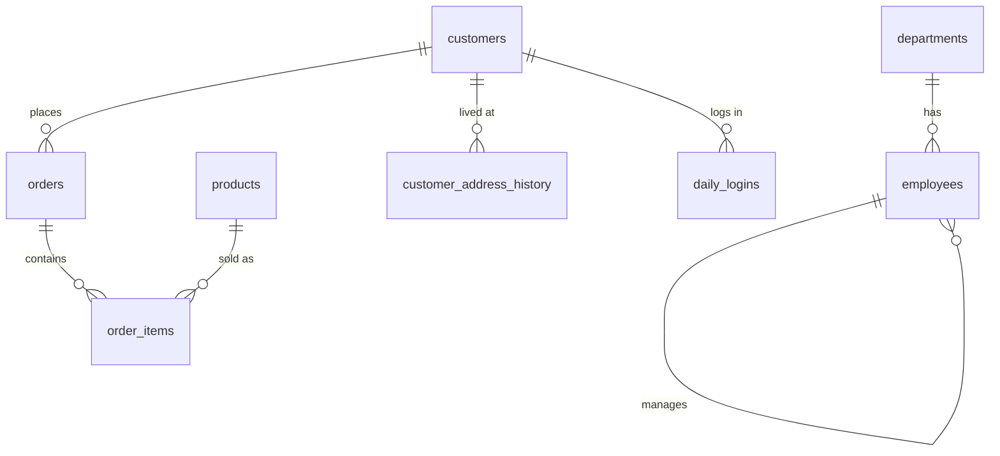

# SQL Practice: Northern Trail Co.

A practice database for learning SQL a little every day, with VS Code and GitHub.

The data is an **invented** Ontario online outdoor-gear store (no real people, no real company). It is
small enough to open in seconds and messy enough to feel like real work: duplicate customers, missing
cities, people who moved house, daily logins, an employee hierarchy.

- **15 topics, 151 questions** (easy, medium, hard), each with a tested solution
- **Runs on your own computer**: Python's built-in SQLite, nothing to install except VS Code and Python
- **Checks your answers** and keeps a score in `progress.md`, which you push to GitHub with your work

---

## 1. Setup (about 5 minutes)

You need VS Code, Python 3 and Git. In the VS Code terminal (**Terminal > New Terminal**) check them:

```bash
python3 --version     # any 3.x is fine
git --version
python3 -c "import sqlite3; print(sqlite3.sqlite_version)"    # should be 3.25 or higher
```

Then build the database (run this inside the project folder):

```bash
python3 build_db.py
```

You should see the row counts and `foreign key problems: 0`. This creates `practice.db`.
You can run it again at any time to reset the database.

**Optional, but nice:** install the extension **SQLite** by *alexcvzz* (`alexcvzz.vscode-sqlite`).
VS Code will suggest it when you open the folder. With it you can press `Cmd+Shift+P`,
choose **SQLite: Open Database**, pick `practice.db`, and browse the tables in the sidebar. To run a query
choose **SQLite: Run Query** (shortcut `Cmd+Shift+Q` on a Mac). The results open in a new tab.

The terminal commands below work without the extension and are what `check.py` is built around.

---

## 2. The daily routine (30 to 45 minutes)

```bash
python3 start.py 1                       # creates practice/01-select-filter.sql with the questions only
```

1. Open the file in `practice/`. Write your SQL under each question and end it with a `;`.
2. Run your queries and look at the results:
   ```bash
   python3 run.py practice/01-select-filter.sql          # runs every query in the file
   python3 run.py practice/01-select-filter.sql 3        # runs only Q3
   python3 run.py -c "SELECT * FROM products LIMIT 5"    # runs one quick query
   ```
   (In VS Code you can also use **Terminal > Run Task > Run current SQL file**.)
3. Check yourself:
   ```bash
   python3 check.py 1
   ```
   A question passes when your query returns the same rows as the solution. Column names and row order
   do not matter. If you are stuck, the answer is in `solutions/` with a note about the technique.
   Try for 10 minutes before you look.
4. Push your work (section 5).

Tips that make the practice work:

- Say out loud what each query does. Interviews test that as much as the SQL.
- Re-do a question you missed two days later without looking at the answer.
- Questions marked `[explore]` have no single right answer. They are for thinking and are not scored.

---

## 3. The 15 topics

| Day | File | What you practise | Questions |
| --- | --- | --- | --- |
| 1 | `01-select-filter` | WHERE, BETWEEN, IN, LIKE, IS NULL, ORDER BY, LIMIT | 12 |
| 2 | `02-joins-basic` | INNER and LEFT JOIN, anti-joins, join fan-out | 10 |
| 3 | `03-joins-advanced` | Self join, EXISTS, INTERSECT, CROSS JOIN, FULL JOIN without FULL JOIN | 8 |
| 4 | `04-aggregates-group-by` | COUNT, SUM, AVG, GROUP BY, HAVING, COUNT DISTINCT | 12 |
| 5 | `05-case-null-strings-dates` | CASE, COALESCE, NULLIF, string and date functions | 12 |
| 6 | `06-subqueries` | Scalar, IN, EXISTS, correlated, derived tables | 10 |
| 7 | `07-ctes` | WITH, multi-step logic | 10 |
| 8 | `08-window-ranking` | ROW_NUMBER, RANK, DENSE_RANK, NTILE, top N per group | 10 |
| 9 | `09-window-aggregates` | Running totals, LAG, LEAD, moving averages, FIRST_VALUE | 10 |
| 10 | `10-duplicates-data-quality` | De-duplication, integrity checks | 10 |
| 11 | `11-dates-cohorts-retention` | Cohorts, retention, year over year | 9 |
| 12 | `12-gaps-and-islands-streaks` | Consecutive-day streaks and gaps | 9 |
| 13 | `13-recursive-hierarchy-calendar` | Recursive CTEs, org chart, generated calendars | 9 |
| 14 | `14-scd2-address-history` | Type 2 history tables and "as of" joins | 10 |
| 15 | `15-interview-business-questions` | Mixed business questions, timed | 10 |

After day 15, redo the hard questions from days 8 to 14 without looking, then write your own questions.

---

## 4. The data



| Table | Rows | Notes |
| --- | ---: | --- |
| `departments` | 7 | |
| `employees` | 49 | `manager_id` points to another employee (NULL for the CEO), 4 levels deep |
| `products` | 60 | 6 categories. 3 launched in late October 2026, 4 are discontinued |
| `customers` | 612 | 12 duplicates with messy e-mails, 18 with no city, 122 never ordered |
| `customer_address_history` | 686 | Type 2 history: `valid_from`, `valid_to`, `is_current`. 104 customers moved once |
| `orders` | 2,401 | 2025-01-01 to 2026-10-30. Status is completed, cancelled or returned |
| `order_items` | 4,333 | `unit_price` is the price at the time, `discount_pct` is 0, 10, 15, 20 or 25 |
| `daily_logins` | 8,014 | 220 customers, 2026-08-01 to 2026-10-31, for streak questions |

Things worth knowing:

- Revenue of an order line = `quantity * unit_price * (1 - discount_pct / 100.0)`.
- Dates are text in `YYYY-MM-DD` form. SQLite has no date type, but these compare and sort correctly.
- January 2025 is the start of the data, so early 2025 is a ramp-up and not a real trend.
- The data is generated with a fixed random seed, so it is the same for everyone.
  `python3 generate_data.py` followed by `python3 build_db.py` rebuilds it exactly.

### SQLite versus the SQL you will use at work

The ideas are the same, but some names differ. Know both when you interview.

| Task | SQLite (here) | SQL Server (T-SQL) | Spark SQL / Databricks |
| --- | --- | --- | --- |
| First N rows | `LIMIT 10` | `SELECT TOP 10` | `LIMIT 10` |
| Days between dates | `julianday(a) - julianday(b)` | `DATEDIFF(day, b, a)` | `datediff(a, b)` |
| Add days | `date(d, '+7 days')` | `DATEADD(day, 7, d)` | `date_add(d, 7)` |
| Year and month | `strftime('%Y-%m', d)` | `FORMAT(d, 'yyyy-MM')` | `date_format(d, 'yyyy-MM')` |
| Join text | `a \|\| b` | `a + b` or `CONCAT` | `concat(a, b)` or `a \|\| b` |
| Text aggregation | `GROUP_CONCAT(x)` | `STRING_AGG(x, ',')` | `concat_ws(',', collect_list(x))` |
| Pivot | `SUM(CASE WHEN ...)` | `PIVOT` or `SUM(CASE ...)` | `PIVOT` or `SUM(CASE ...)` |
| Filter on window result | CTE, then `WHERE` | CTE, then `WHERE` | `QUALIFY` is available |

Solutions avoid `RIGHT JOIN` and `FULL JOIN` on purpose, because older SQLite versions do not have them.

---

## 5. Push to GitHub

### First time

1. On github.com, create a new repository named `sql-practice`. Leave it empty (no README, no .gitignore).
2. In the VS Code terminal, inside this folder:

```bash
git init
git add .
git commit -m "Start SQL practice"
git branch -M main
git remote add origin https://github.com/edutanvir/sql-practice.git
git push -u origin main
```

### Every day

```bash
python3 check.py 3                       # use today's topic number
git add practice progress.md
git commit -m "Day 3: joins, 8/8 correct"
git push
```

If `git push` says the push was rejected because the remote has work you do not have, run
`git pull --rebase origin main` and then `git push` again.

You can also use the Source Control panel in VS Code (the branch icon on the left): type a message, click
**Commit**, then **Sync Changes**.

`practice.db` is not pushed (it is listed in `.gitignore`) because anyone can rebuild it with
`python3 build_db.py`.

> The `solutions/` folder is part of this project. If your repository is public, other people can read it.
> To keep the answers private, add the line `solutions/` to `.gitignore` before your first push, or make
> the repository private.

---

## Files

```
data/                CSV files (the data)
schema.sql           table definitions
build_db.py          builds practice.db from schema.sql and data/
generate_data.py     creates the CSV files (fixed seed, so repeatable)
start.py             creates a practice file with the questions only
run.py               runs a .sql file or one query and shows the results
check.py             compares your answers with solutions/ and updates progress.md
practice/            YOUR answers (this is what you push)
solutions/           the answers and notes
progress.md          your score per topic (written by check.py)
.vscode/             recommended extension and run tasks
```
